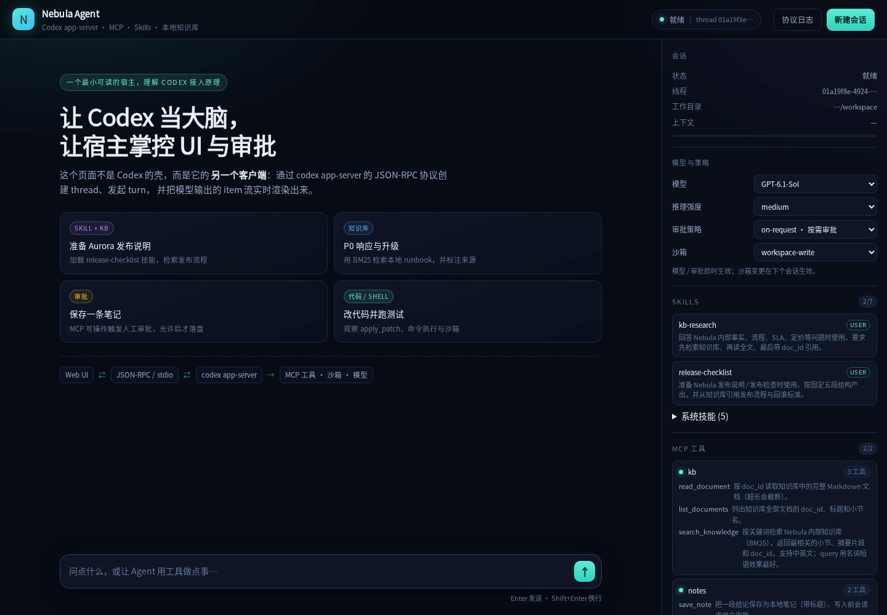
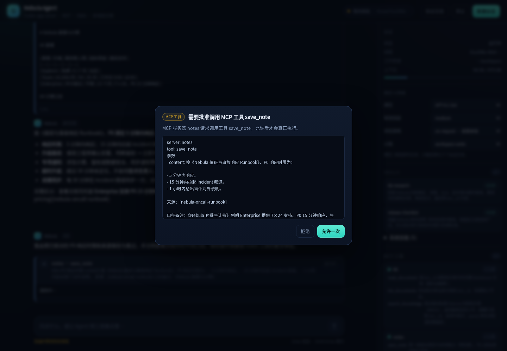
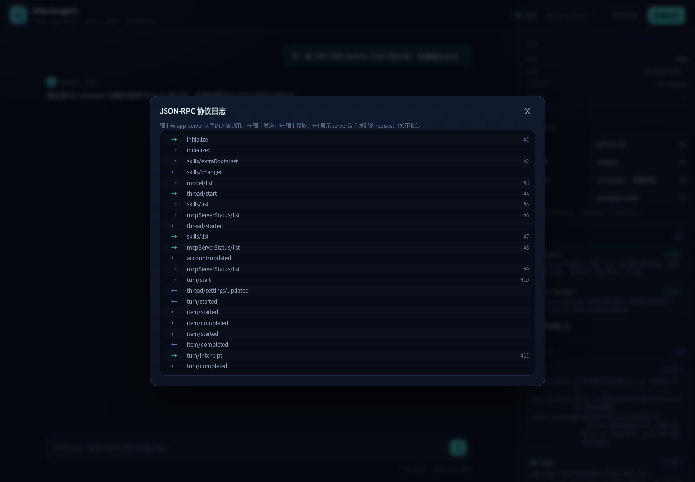
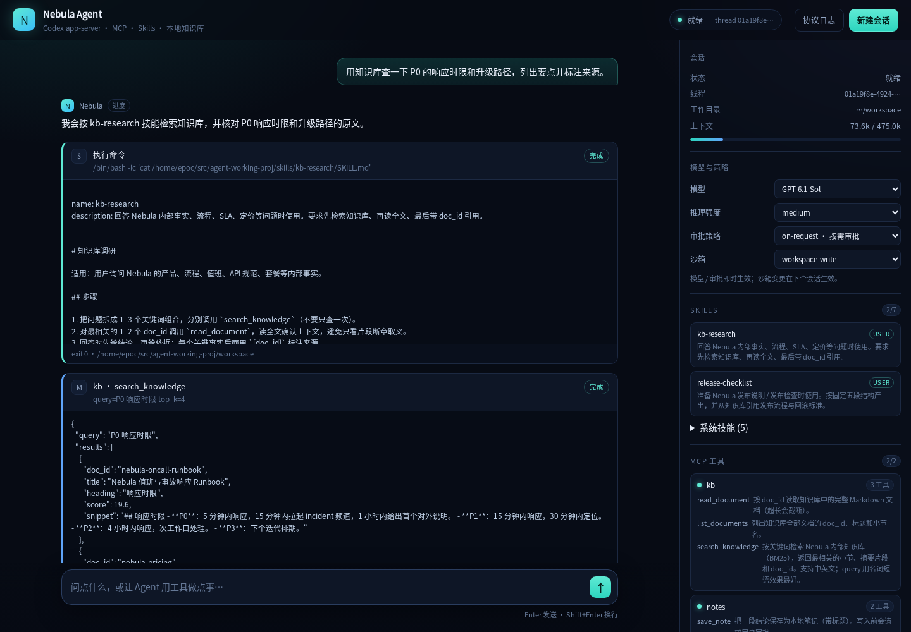
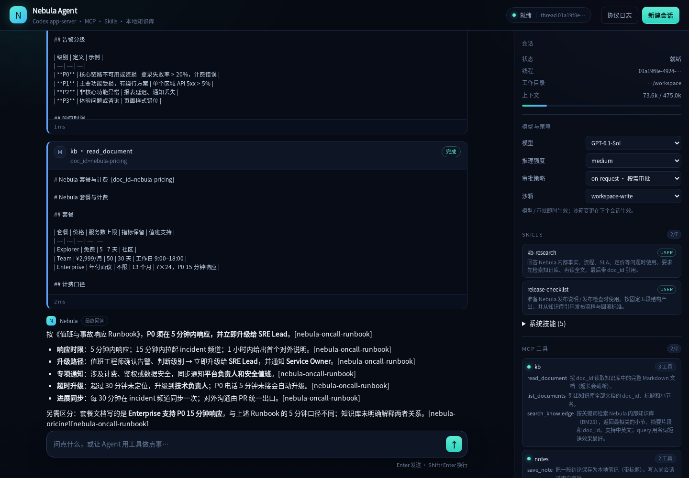

# Nebula Agent — 一个用 Codex app-server 搭起来的 Agent Demo

> 不自己写模型循环，而是把 **Codex** 当成 agent runtime：宿主（这个 Web 应用）只负责
> 会话管理、UI、审批和产品逻辑；模型调用、工具执行、沙箱、上下文压缩都交给
> `codex app-server`。

这个仓库的目标是**把接入原理讲清楚**，所以代码刻意保持小：后端约 1000 行 Node，MCP 服务
只用 Python 标准库，没有数据库、没有向量库、没有 npm 依赖。跑起来后可以看到一条完整的链路：

```
浏览器 ⇄ Node 宿主 (HTTP + SSE) ⇄ codex app-server (JSON-RPC / stdio)
                                        ├─ 模型（OpenAI）
                                        ├─ 内置工具（shell / apply_patch / 沙箱）
                                        ├─ MCP 服务器：kb（BM25 知识库）
                                        ├─ MCP 服务器：notes（写操作，走审批）
                                        └─ Skills（skills/*/SKILL.md）
```



## 这个 demo 演示了什么

| 能力 | 在这个仓库里的位置 | 你能观察到什么 |
| --- | --- | --- |
| **流式对话** | `src/agent.mjs` | `thread/turn/item` 事件流、agent 文本 delta、reasoning、token 用量 |
| **工具接入（MCP）** | `mcp/kb_server.py`、`mcp/notes_server.py` | app-server 启动外部 MCP 进程、发现工具、模型调用、结果回填 |
| **工具接入（内置）** | `workspace/` | shell 命令、`apply_patch` 文件修改、沙箱限制、命令输出流 |
| **Skills 接入** | `skills/` | 技能目录被扫描成元数据注入 prompt，模型按需读取 `SKILL.md` |
| **本地知识库** | `knowledge/`、`mcp/kb_server.py` | 中文 BM25 检索、小节级 chunk、`doc_id` 引用；无需向量库 |
| **人工审批** | `src/agent.mjs`、`web/app.js` | server 反向发起请求，宿主弹窗，用户决定后回写 result |
| **宿主直调工具** | 侧栏“知识库检索” | 不经过模型，宿主直接 `mcpServer/tool/call` 复用同一个知识库 |
| **会话控制** | 侧栏“模型与策略” | 切换模型 / 推理强度 / 审批策略 / 沙箱，新建会话 |
| **协议可观察** | “协议日志”按钮 | 实时看到宿主与 app-server 之间的方法调用方向 |

## 快速开始

前置条件：

- [Codex CLI](https://github.com/openai/codex)（本 demo 在 `codex-cli 0.166.0` 上验证），且已经登录（`codex login`）
- Node.js ≥ 20
- Python ≥ 3.10（只用标准库）

```bash
npm run setup    # 创建 .codex-home/，把 ~/.codex/auth.json 软链进来
npm start        # 启动 http://127.0.0.1:4317
```

打开 <http://127.0.0.1:4317>，点首页的四个示例卡片即可。也可以跑无头冒烟测试：

```bash
npm run smoke    # 会真实调用模型：握手 → KB 检索 → 直调 MCP → 审批 → 落盘
```

### 为什么要有独立的 `.codex-home/`

app-server 需要读写自己的状态（session、sqlite、skills 缓存）。demo 默认把 `CODEX_HOME`
指向仓库内的 `.codex-home/`，只把**登录凭证**软链进来——这样不会污染你日常使用的
`~/.codex/config.toml`，也方便随时删掉重来。

```bash
CODEX_HOME=/path/to/home npm start   # 也可以用别的目录
```

如果 `~/.codex/auth.json` 不存在，先运行 `codex login`，或把 `OPENAI_API_KEY` 写进
`.codex-home/auth.json`（Codex 支持 API key 模式）。

## 四个接入点，分别看哪里

### 1. 工具：把业务系统做成 MCP Server

`src/config.mjs` 在 `thread/start` 时通过 `config.mcp_servers` **按会话注入**外部工具：

```js
{
  mcp_servers: {
    kb: {
      command: "python3",
      args: ["mcp/kb_server.py"],
      env: { KB_DIR: "knowledge" },
      default_tools_approval_mode: "approve", // 只读检索自动放行
    },
    notes: {
      command: "python3",
      args: ["mcp/notes_server.py"],
      default_tools_approval_mode: "prompt",  // 写操作每次审批
    },
  },
}
```

app-server 会负责启动进程、完成 MCP `initialize`、拉取 `tools/list`，然后：

- 把工具 schema 交给模型；
- 模型决定调用时，由 app-server 执行 `tools/call`；
- 结果以 `mcpToolCall` item 的形式流式返回给宿主；
- 有副作用的调用会先变成一条 `mcpServer/elicitation/request` 发给宿主审批。

换一个业务只需要写一个新的 MCP server，**宿主和 UI 一行都不用改**。这就是 MCP 作为
“工具接入缝”的价值。

### 2. Skills：给模型“按需加载的操作手册”

```
skills/
  release-checklist/SKILL.md
  kb-research/SKILL.md
```

每个 `SKILL.md` 带 YAML frontmatter：

```markdown
---
name: kb-research
description: 回答 Nebula 内部事实、流程、SLA、定价等问题时使用。
---

# 知识库调研
1. 先用 search_knowledge 拆关键词检索……
```

启动时宿主调用 `skills/extraRoots/set` 把仓库的 `skills/` 注册为技能根目录；
app-server 扫描后把 **name + description + 文件路径** 注入 system prompt。
模型判断需要时，会自己 `cat <path>/SKILL.md` 读取正文（在 demo 的“执行命令”卡片里能看到），
再按里面的步骤干活。

这样做的好处：技能正文不占常驻上下文，只有被选中才加载；技能就是仓库里的 markdown，
可以用 Git 做版本管理和 review。

### 3. 本地知识库：用 BM25 做最小可跑的 RAG

`mcp/kb_server.py` 对 `knowledge/*.md` 建索引：

- 按 Markdown 二级标题切块（chunk），检索粒度是“小节”；
- 中文按 **单字 + 二元组** 切词，英文/数字按词切分；
- BM25（k1=1.2, b=0.75）打分，返回 `doc_id / heading / score / snippet`；
- 工具契约：`search_knowledge` → `read_document` → `list_documents`；
- 同时暴露 MCP resources（`kb://docs/<doc_id>`），支持 resources 的客户端可直接读原文。

知识库内容是虚构的 Nebula 内部文档（发布流程、值班 runbook、API 规范、定价），
所以模型**必须先检索才能答对**——这能直观看出“工具调用”和“引用来源”是否真的发生。

要换成向量检索，只需要替换 `KnowledgeBase.search()` 的实现，MCP 工具签名不变。

### 4. 审批：server 反向请求，宿主做决定

这是 app-server 接入里最容易被忽略、也最关键的一点：**JSON-RPC 是双向的**。
除了宿主发 `thread/start`、`turn/start`，server 也会发 request 给宿主：

| server → 宿主的方法 | 场景 | demo 的响应 |
| --- | --- | --- |
| `item/commandExecution/requestApproval` | 命令需要提权 / 超出沙箱 | `{decision:"accept" \| "decline" \| "cancel"}` |
| `item/fileChange/requestApproval` | 写工作区之外的文件 | 同上 |
| `mcpServer/elicitation/request` | MCP 工具调用审批 / 表单 | `{action:"accept"}` 或 `{action:"decline"}` |
| `item/tool/requestUserInput` | 模型反问用户 | demo 返回空答案（未做问卷 UI） |

宿主把这些请求挂起、显示在 Web UI，用户点击后把结果写回对应的 `id`。超过 10 分钟未处理会
自动 decline，避免回合永久卡住。



## 一次回合的完整时序

```text
Browser               宿主 (Node)                 app-server              MCP / 工具
  │  POST /api/message    │                            │                       │
  ├──────────────────────►│  turn/start                │                       │
  │                       ├───────────────────────────►│                       │
  │                       │◄── turn/started ───────────┤                       │
  │  SSE: turn_started    │                            │  tools/call           │
  │◄──────────────────────┤◄── item/started ───────────┼──────────────────────►│
  │  SSE: item            │                            │◄──── result ──────────┤
  │◄──────────────────────┤◄── item/completed ─────────┤                       │
  │                       │◄── item/agentMessage/delta ┤                       │
  │  SSE: delta           │                            │                       │
  │◄──────────────────────┤                            │                       │
  │                       │◄── turn/completed ─────────┤                       │
  │  SSE: turn_completed  │                            │                       │
  │◄──────────────────────┤                            │                       │
```

更细的方法表、字段和错误处理见 [docs/PROTOCOL.md](docs/PROTOCOL.md)。



## 代码地图

```
src/
  codex-client.mjs   约 200 行：stdio JSONL 传输、请求/响应、server 反向请求分发
  agent.mjs          会话生命周期：握手、thread、turn、审批、事件归一化
  server.mjs         HTTP + SSE + 静态文件；把 Agent 事件广播给浏览器
  config.mjs         路径、模型、MCP 服务器、system prompt
web/
  index.html / style.css / app.js   无框架前端，SSE 渲染 + 审批弹窗 + 协议面板
mcp/
  mcp_base.py        极简 MCP stdio server 基类（JSON-RPC）
  kb_server.py       BM25 知识库（search / read / list + resources）
  notes_server.py    写笔记（save / list），演示有副作用工具的审批
skills/              两个示例技能：release-checklist、kb-research
knowledge/           5 篇虚构内部文档
workspace/           Codex 线程的 cwd，shell/文件工具被沙箱限制在这里
scripts/
  setup.mjs          创建 CODEX_HOME、软链 auth、环境检查
  smoke.mjs          无头端到端测试
docs/
  PROTOCOL.md        协议与接入原理详解
  screenshots/
```

## 场景示例

1. **“准备 Aurora 发布说明”**：模型先读 `release-checklist` 技能 → 调 `kb.search_knowledge`
   → `kb.read_document` → 按五段结构输出，并带 `[nebula-release-process]` 引用。
2. **“P0 响应时限”**：纯知识库问答，看 BM25 命中和引用。
3. **“保存成笔记”**：`notes.save_note` 触发 MCP 审批，允许后才写入 `demo-data/notes.json`。
4. **“给 healthcheck 加 retries 并跑测试”**：看 `commandExecution`、`fileChange`（diff）、
   以及 `npm test` 的输出流。



最终回答会带 `[doc_id]` 引用，必要时还会指出文档之间的口径差异：



## 配置

| 环境变量 | 默认值 | 说明 |
| --- | --- | --- |
| `PORT` | `4317` | Web 端口 |
| `HOST` | `127.0.0.1` | 只监听本机 |
| `CODEX_HOME` | `.codex-home/` | app-server 的独立状态目录 |
| `DEMO_WORKSPACE` | `workspace/` | Codex 线程的 cwd / 沙箱可写目录 |
| `DEMO_MODEL` | 自动选 | 指定模型 id |
| `CODEX_BIN` | `codex` | Codex 可执行文件 |
| `PYTHON` | `python3` | 启动 MCP 服务器的解释器 |
| `DEBUG_CODEX` | 空 | `1` 时把 app-server 的 stderr 打到终端 |

模型、推理强度、审批策略、沙箱也可以在 UI 里切换。注意：**沙箱是线程级设置**，改了之后要点
“新建会话”才生效；模型和审批策略在下一轮生效。

## 往生产走要补什么

这个 demo 刻意只做“单进程、单会话、内存态”。真要做产品，至少还要：

- **多用户 / 多会话**：一个 `threadId` 对应一个会话；用 `thread/list`、`thread/resume`、
  `thread/read` 做列表和回放，把 thread 归属到用户。
- **持久化**：审批记录、审计日志、工具调用结果落库；app-server 自己的 rollout 文件不能当业务库。
- **鉴权**：app-server 的 `account/login/start`、`account/read` 可以接账号体系；不要把
  `danger-full-access` 暴露给普通用户。
- **检索升级**：把 BM25 换成 embedding + 向量库，或者 hybrid；工具契约保持不变。
- **审批策略**：按工具 / 参数 / 用户角色配置自动放行规则（MCP 的 `readOnlyHint`、
  `default_tools_approval_mode` 只是起点），并记录“谁批准了什么”。
- **可观测性**：接入 OpenTelemetry，把 `turn`、工具调用、审批等待时间做成指标。
- **协议版本**：app-server 仍是 experimental，方法会变；用
  `codex app-server generate-json-schema --out ./schema` 固定你依赖的版本。

## 已知限制

- 单会话：刷新页面会从内存事件流重建当前会话；宿主重启后旧会话不会自动恢复。
- 审批 UI 只覆盖命令 / 文件 / MCP 三类；`request_user_input` 和 `permissions` 未做完整交互。
- 知识库为演示用虚构数据；BM25 没有做同义词和向量召回。
- 未做鉴权和多租户，请只在本机运行。

## 参考

- Codex CLI: <https://github.com/openai/codex>
- app-server 协议 schema：`codex app-server generate-json-schema --out ./schema`
- MCP 规范: <https://modelcontextprotocol.io>

> 本仓库所有 Nebula 相关内容（产品、流程、SLA、价格）均为演示虚构，与任何真实公司无关。
